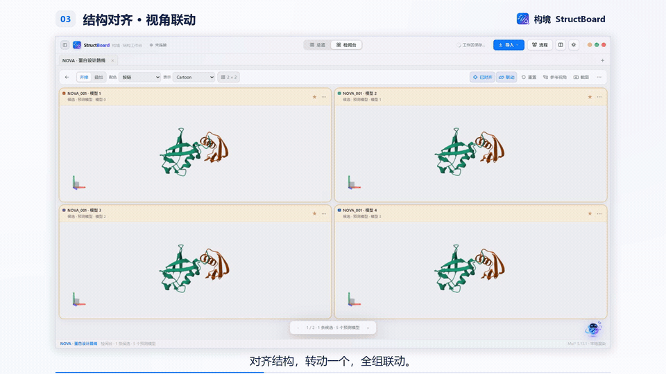
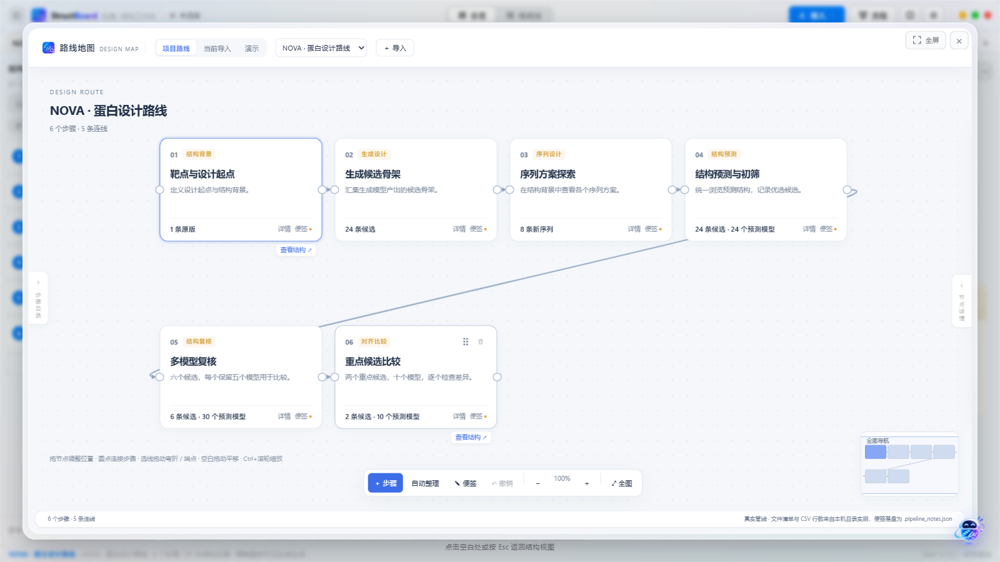
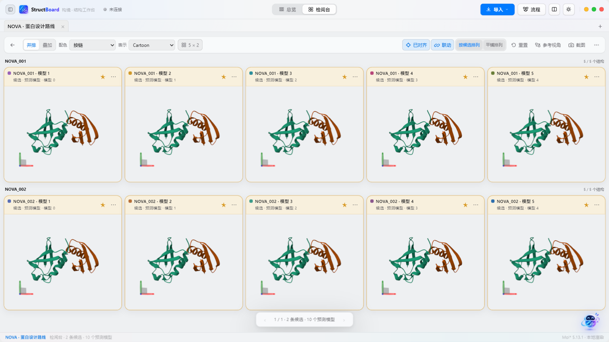
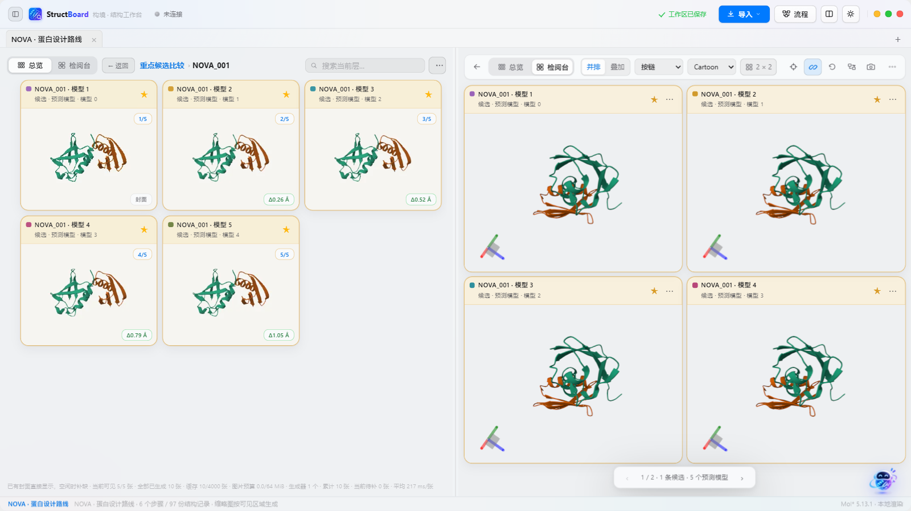

# 构境 · StructBoard

**看清每个候选，留下判断依据。**

面向 AI 蛋白设计与药物研发的本地结构工作台。把已有结构、设计步骤与复核记录放在同一工作区；浏览路线、比较模型，记录取舍。

[下载 Windows 安装版](https://github.com/chopinone/StructBoard/releases/latest) · [观看 34 秒演示](https://chopinone.github.io/StructBoard/) · [从源码构建](#从源码构建)

[](https://chopinone.github.io/StructBoard/)

*上方为无声片段；点击进入介绍页，直接播放带中文配音的 34 秒完整视频。画面使用虚构的 NOVA 管线与公开示例结构，不包含个人研究数据。*

## 一眼看懂设计路线

把步骤与连线放在一张地图上，随手调整节点位置和连线，也可一键自动整理。从路线节点直接定位到结构。



## 把候选放在一起比较

多个模型并排查看、结构对齐、视角联动。按候选分组或逐个平铺，星标和参考结构保留在当前工作区。



## 总览与检阅同时进行

左边浏览候选与封面，右边旋转和比较结构。多个管线可分标签管理，也可拆成独立窗口。



## 两种独立的 AI 入口

**外部客户端 · MCP**：在 Codex、WorkBuddy、Claude Code、ZCode 或 Antigravity 中连接构境，按授权读取工作区、打开视图或编辑内容。模型服务在客户端侧配置。多数操作按授权执行；修改管线定义、指定路线删除及撤销操作需在构境确认。

**内置 AI 助手**：直接在构境内提问，单独配置 OpenAI 兼容或 Anthropic 模型接口。助手连续执行只读查询，过程默认折叠；改变数据或视图前由你确认。

本地读取与渲染不依赖 AI。启用 AI 后，所发送的对话、上下文和工具结果由配置的服务或客户端处理。

图片和视频的素材说明见 [演示素材说明](docs/MEDIA.md)。

## Windows 安装

适用于 Windows 10/11 x64。下载 [StructBoard-0.3.0-windows-x64-setup.exe](https://github.com/chopinone/StructBoard/releases/download/v0.3.0/StructBoard-0.3.0-windows-x64-setup.exe)，安装后打开构境。安装器检查 Microsoft WebView2；缺少时运行包内的微软官方引导安装器，这一步需要联网。

也可下载 [便携 ZIP](https://github.com/chopinone/StructBoard/releases/download/v0.3.0/StructBoard-0.3.0-windows-x64.zip)，解压整个文件夹后运行 `StructBoard.exe`。请保留 `backend`、`bootstrap` 和 `manifest.json`；不要只复制一个 EXE。便携版同样需要 Microsoft WebView2 Runtime。

普通用户无需安装 Python、Node.js 或 Rust。用户工作区和管线保存在当前用户的 `%APPDATA%\com.structboard.desktop`。安装升级和卸载保留该目录。

## 第一次使用

点击「先看示例」打开 Aurora 演示管线：4 个步骤，31 份合成结构记录，包含多模型分组、星标、教学分数和便签。所有坐标、序列、分数均由程序人工生成，不是实验数据或科研预测，也没有真实项目输入。

自己的结构可通过「导入」打开 PDB、mmCIF、文件夹或管线 JSON。管线格式见 [pipelines/SCHEMA.md](pipelines/SCHEMA.md)。结构渲染和文件读取在本机完成。

顶部「＋」创建独立的空白标签，可导入文件、文件夹或管线 JSON；多个标签分别保存和恢复，拖出标签栏可打开独立窗口。收起侧栏后主内容占用全部宽度，用顶栏同一个按钮展开。

从外部拖入结构时，空白标签直接打开；已有内容的工作区默认新建标签。拖到蓝框标出的具体步骤或文件夹时，会提示“添加到……”并仅追加到这个位置。自动生成的候选文件夹将外部文件收在“外部导入”子文件夹中，避免把它当作原候选的预测模型。文件名和路径仍保留真实来源。

## 连接 AI 客户端

1. 先安装并登录需要使用的 Codex、WorkBuddy、Claude Code、ZCode 或 Antigravity。
2. 打开构境顶栏的连接灯，在「授权范围」勾选所需权限。读取为必选，视图和编辑按需选择。
3. 在「添加到 AI 客户端」找到对应客户端，点击「添加」。构境备份原配置、合并自己的服务项，并为该客户端保存独立授权。
4. 在客户端刷新 MCP。没有刷新入口时，正常重启客户端。连接灯显示客户端名称，点开可查看每个授权的连接状态。

「已添加」表示配置已保存，「已连接」依据实际心跳显示，两者有区别。首次登记后无需每次复制配置或重新配对。构境重启后，仍在运行的连接器会重新发现本机服务并验证原授权；已退出的连接器由 AI 客户端重新启动。编辑请求在断线后不会自动重放。

每家客户端使用自己的凭据文件。撤销授权或「全部停止」后，需要重新添加/配对。只读配置、企业策略、自定义配置目录或未来客户端格式变化可能需要手动配置；备用「复制 MCP 配置」入口仍然保留。Claude Code 与 Claude Desktop 是不同客户端，本版向导适配的是 Claude Code。

## 从源码构建

构建环境需要 Windows x64、Python 3.12、Node.js 22.12+、Rust、MSVC C++ Build Tools 和 Windows SDK。普通安装用户不需要这些工具。

```powershell
python -m venv .venv
.\.venv\Scripts\python.exe -m pip install -r requirements-dev.txt
npm ci
npm run build:ui
npm run check:ui
npm run test:ui
.\.venv\Scripts\python.exe -I -B tools/run_all_tests.py
$env:STRUCTBOARD_BUILD_PYTHON = (Resolve-Path .\.venv\Scripts\python.exe).Path
python -I -B build_desktop.py
python -I -B tools/build_public_release.py --release dist/StructBoardTauri --output dist/public
```

构建默认只写 `dist`，不安装到开发者目录。正式打包会从 Tauri 官方构建工具发布页下载 NSIS 并验证校验和，从微软下载 WebView2 引导安装器并验证微软数字签名。`dist/public` 下生成安装器、便携 ZIP、公开源码 ZIP 和 `SHA256SUMS.txt`。

公开源码包采用明确的文件清单，不含本机工作区、授权、备份、日志、内部交接记录或旧 Git 历史。可以从 `StructBoard-source` 文件夹新建 GitHub 仓库。源码快照附带校验记录，可在没有原开发者 Git 仓库的情况下构建。

`.github/workflows/windows-release.yml` 提供手动执行的 Windows 构建和工件上传，不自动创建公开 Release。

## 开源协议

当前主分支第一方代码按 **MIT License** 发布，见 [LICENSE](LICENSE)。你可以使用、修改、分发和商用；再分发时须保留版权及许可声明。第三方组件保留各自许可证，见 [THIRD_PARTY_NOTICES.md](THIRD_PARTY_NOTICES.md)。

此前发布的 v0.3.0 源码 ZIP、安装版和便携版仍按各自随包附带的 **GPL-3.0-only** 许可发布。该许可变更适用于当前主分支及之后明确采用 MIT 的版本，不追溯改写旧发行包。

Copyright (C) 2026 chopinone. 本软件按现状提供，不附带任何担保。

## 数据隔离与参与开发

公开仓库只包含明确清单内的源代码、人工演示生成器、测试和构建文件。工作区、结构原始数据、管线 JSON、便签、截图、日志及授权信息均属于用户私有数据。

- [数据隔离](PRIVACY.md)
- [架构说明](ARCHITECTURE.md)
- [参与开发](CONTRIBUTING.md)
- [发布说明](RELEASING.md)

提交前运行 `python tools/check_public_source.py`。新文件须明确加入 `public-source.json` 并接受人工检查；`.gitignore` 不能清除旧历史中的信息。
